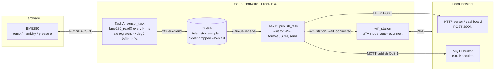
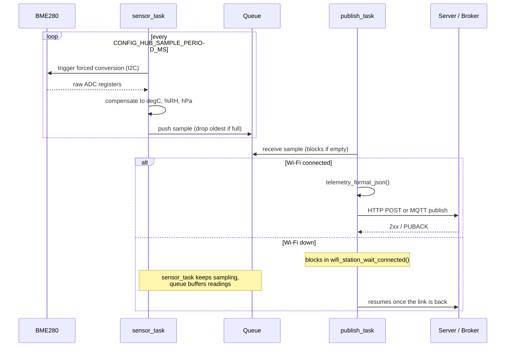

# WiFi Sensor Hub

A stand-alone environmental monitoring station built in C with ESP-IDF for the ESP32.

The ESP32 acts as a mini edge-computing server: it periodically samples ambient temperature, relative humidity, and barometric pressure from a Bosch BME280 sensor over $\text{I2C}$, compensates the raw ADC registers into human-readable physical units ($^\circ\text{C}$, $\% \text{RH}$, and $\text{hPa}$), and broadcasts the data across your local network via HTTP POST or MQTT.

## How It Works

1. **Physical Sensing (Hardware Level):**
   - Every sampling interval, the ESP32 triggers a single forced-mode conversion on the BME280 over the $\text{I2C}$ bus.
   - The sensor captures ambient conditions and writes the raw ADC data to its registers.
   - The on-chip driver reads those registers and executes Bosch compensation math using factory trimming parameters stored on the sensor.

2. **On-Chip Data Handling (FreeRTOS / Firmware Level):**
   - **Task A (`sensor_task`):** Dedicated exclusively to communicating with the BME280 over $\text{I2C}$ and placing timestamped readings into a FreeRTOS queue.
   - **Task B (`publish_task`):** Drains the queue, serializes readings into JSON payloads, and handles transmission over the network.
   - **Fault Isolation:** If Wi-Fi disconnects or reconnects, the sensor task continues sampling uninterrupted on its regular cadence. Readings buffer in the queue (oldest dropped when full) until network connectivity is restored.

3. **Network Transmission (Network Level):**
   - Connects to your Wi-Fi network in Station (STA) mode with automatic background reconnection.
   - Formats each reading as a compact JSON object:
     ```json
     {
       "device_id": "esp32-hub-01",
       "timestamp_ms": 124500,
       "temperature_c": 22.45,
       "humidity_pct": 48.30,
       "pressure_hpa": 1013.25
     }
     ```
   - Sends telemetry via either **HTTP POST** (to a REST API or dashboard) or **MQTT** (QoS 1 publish to a broker such as Mosquitto).

## Hardware Requirements & Wiring

- **ESP32** development board (e.g., ESP32-WROOM-32)
- **Bosch BME280** breakout module (supports I2C address `0x76` or `0x77`)
- 4-pin jumper wire connection:

| BME280 Pin | ESP32 GPIO | Notes |
|:----------:|:----------:|:------|
| **VIN**    | **3V3**    | Power supply (3.3V) |
| **GND**    | **GND**    | Ground |
| **SDA**    | **GPIO 21**| Configurable in `menuconfig` |
| **SCL**    | **GPIO 22**| Configurable in `menuconfig` |

## Software Requirements

- **ESP-IDF** v5.2 or later (configured Xtensa toolchain)
- **Doxygen** (optional, to generate API documentation from `Doxyfile`)

## Configuration

Run the interactive configuration menu:

```bash
idf.py menuconfig
```

Navigate to **WiFi Sensor Hub** to configure:
- **Device ID:** Identifier sent with every JSON payload and MQTT topic.
- **Sampling period (ms):** Interval between sensor readings (default: `5000` ms).
- **Queue length:** Buffer size for readings when Wi-Fi is down (default: `16`).
- **Wi-Fi Settings:** SSID and WPA2 passphrase.
- **BME280 (I2C):** Port, SDA pin, SCL pin, bus clock frequency, and I2C address (`0x76` or `0x77`).
- **Transport:**
  - **HTTP POST:** Target endpoint URL (e.g., `http://192.168.1.100:8000/api/readings`).
  - **MQTT:** Broker URI (`mqtt://192.168.1.100:1883`) and publish topic (`wifi-sensor-hub/readings`).

## Building & Flashing

```bash
# 1. Set the target chip
idf.py set-target esp32

# 2. Build the firmware
idf.py build

# 3. Flash to board and monitor serial output (replace PORT with your device, e.g., COM3 or /dev/ttyUSB0)
idf.py -p PORT flash monitor
```

To exit the serial monitor, press `Ctrl+]`.

## Architecture

### System overview



### One reading, including a Wi-Fi outage



## Project Structure

```
wifi-sensor-hub/
├── CMakeLists.txt              # Top-level project CMake configuration
├── sdkconfig.defaults          # Default ESP-IDF configuration overrides
├── Doxyfile                    # Doxygen API documentation generator config
├── main/
│   ├── CMakeLists.txt          # Main component registration
│   ├── Kconfig.projbuild       # Configuration menu definitions
│   └── main.c                  # System entrypoint, FreeRTOS tasks & queue
└── components/
    ├── bme280/                 # I2C driver & Bosch compensation formulas
    │   ├── CMakeLists.txt
    │   ├── include/bme280.h
    │   └── bme280.c
    ├── wifi_station/           # Wi-Fi station mode with auto-reconnection
    │   ├── CMakeLists.txt
    │   ├── include/wifi_station.h
    │   └── wifi_station.c
    └── telemetry/              # JSON formatting, HTTP POST & MQTT clients
        ├── CMakeLists.txt
        ├── include/telemetry.h
        └── telemetry.c
```

## License

See LICENSE file for details.

## Contributing

Contributions are welcome! Please open an issue or submit a pull request.